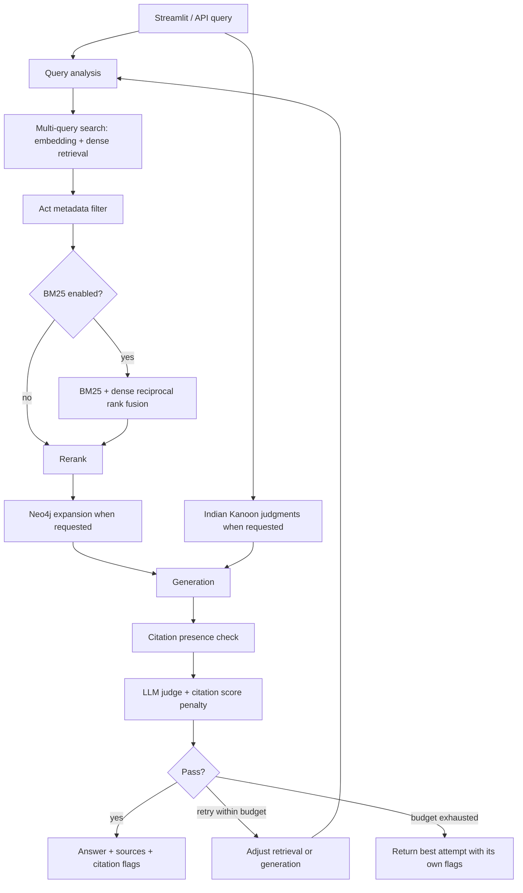

# Legora

> **Not legal advice.** Legora is an experimental research system, not a lawyer or a substitute for legal counsel. Answers may contain incorrect, outdated, incomplete, or unsupported legal statements. Verify the current law and consult a qualified lawyer before acting.

Finding the provisions relevant to a layperson's legal question requires navigating statute structure, terminology, cross-references and judgments. Legora explores retrieval-augmented answers over the Constitution of India, Bharatiya Nyaya Sanhita (BNS), Bharatiya Nagarik Suraksha Sanhita (BNSS), Bharatiya Sakshya Adhiniyam (BSA), and on-demand Indian Kanoon judgments, combining semantic retrieval, optional lexical retrieval, graph context and source checks. Its intended benefit is easier access to supporting material; the checked-in reports do **not** establish retrieval accuracy, answer quality or latency improvements.

Screenshot/GIF placeholders — no demonstration assets are supplied yet:

- [ ] Screenshot: a question, answer and retrieved statutory sources in Streamlit.
- [ ] Screenshot: an unsupported-citation warning and evaluation status.
- [ ] GIF: retrieval, graph context, retry and final response for a real query.

## Architecture

Python hosts a FastAPI backend and Streamlit HTTP client. Sentence Transformers
embeds questions, Qdrant stores statute vectors/payloads, BAAI/bge-reranker-large
reranks candidates, Neo4j supplies hierarchy/reference context, and Gemini performs
analysis, generation and judging.



The filter box is conceptual: the act constraint is passed into Qdrant search,
not applied after discarding search results. Explicit provision lookup, when
configured, prepends actual stored hits and preserves them after reranking.
Graph expansion follows `(child)-[:BELONGS_TO]->(parent)` upward and reverses
that traversal for descendants. Graph and judgment calls can be disabled per query.

Unsupported statutory citations lower the evaluation score and prevent PASS,
using the existing retry budget. The checker verifies source presence/identity;
it does not prove that a provision entails the answer's legal claim. The API
returns `unsupported_citations`, `citation_precision` and per-mention
`citation_checks`; precision is undefined for answers without citations.

## Corpus statistics

The source of this table is [results/corpus_stats.md](results/corpus_stats.md),
with machine-readable provenance in [corpus_stats.json](results/corpus_stats.json).
The read-only [counting script](scripts/corpus_stats.py) attempted live storage
reads. Qdrant reported `ResponseHandlingException`; Neo4j reported `ValueError`.
Both were unavailable. These failures do **not** establish an empty corpus.
Rows identify the intended acts; their stored coverage is unverified.

| Act | Unique stored chunks | Graph nodes | Directed graph edges |
|---|---:|---:|---:|
| BNS | Not measured | Not measured | Not measured |
| BNSS | Not measured | Not measured | Not measured |
| BSA | Not measured | Not measured | Not measured |
| Constitution | Not measured | Not measured | Not measured |
| Unmapped | Not measured | Not measured | Not measured |
| Total | Not measured | Not measured | Not measured |

Chunk counts deduplicate actual stored `chunk_id` values. The JSON also reports
raw points, duplicate chunk points and points without IDs when storage is readable.
Graph edges include every directed relationship, including inverse hierarchy
edges; cross-act edges belong to their source act. Chunk acts use recognized
metadata with an ID fallback; unresolved identities stay in the Unmapped row.
Freeze ingestion while collecting counts from both stores.

## Results recorded in this repository

**No completed benchmark is present.** All tables below reflect only checked-in
`results/` outputs. “Not evaluated” and “Not measured” are missing measurements,
not zero scores. There are no demonstrated improvements or confidence intervals.
Configuration defaults and sample sizes elsewhere in this README are experiment
settings, not measured outcomes.

### Retrieval ablation

Source: [retrieval_ablation.md](results/retrieval_ablation.md).
[retrieval_ablation.csv](results/retrieval_ablation.csv) contains only a header.
The report states that no reviewed, answerable gold items are available.

| Configuration | BM25/RRF | Exact lookup | Recall@5 | MRR |
|---|---|---|---|---|
| A | False | False | Not evaluated | Not evaluated |
| B | False | False | Not evaluated | Not evaluated |
| C | False | False | Not evaluated | Not evaluated |
| D | False | False | Not evaluated | Not evaluated |
| E | False | False | Not evaluated | Not evaluated |
| F | False | False | Not evaluated | Not evaluated |
| G | True | True | Not evaluated | Not evaluated |

The presets compare dense search, act filtering, multi-query expansion,
reranking, legal boosts, graph context and BM25 fusion; their precise definitions
are in [the evaluation guide](eval/README.md#retrieval-ablation-benchmark).
Root/exact Recall@1/5/10, MRR, nDCG@10, graph context recall, per-intent breakdowns,
bootstrap intervals and failure lists have not been computed in these outputs.

### Answer quality

Source: [answer_eval.md](results/answer_eval.md): no reviewed gold items and no
computed answer metrics.

| Measure | Recorded result |
|---|---|
| Citation precision | Not measured |
| Unsupported-citation rate | Not measured |
| Answer contains expected provision | Not measured |
| Context-supported expected provision | Not measured |
| Out-of-scope refusal rate | Not measured |

These are citation/coverage/scope measures, not a legal correctness guarantee.

### Latency and quality trade-offs

Source: [latency.md](results/latency.md): no paired measurements. The planned
comparison requires restored stores and reviewed gold questions.

| Stage | Before p50 / p95 (ms) | After cold p50 / p95 (ms) | After warm p50 / p95 (ms) |
|---|---|---|---|
| Analysis | Not measured | Not measured | Not measured |
| Embedding | Not measured | Not measured | Not measured |
| Vector search | Not measured | Not measured | Not measured |
| Rerank | Not measured | Not measured | Not measured |
| Neo4j expansion | Not measured | Not measured | Not measured |
| Generation | Not measured | Not measured | Not measured |
| Judge | Not measured | Not measured | Not measured |
| Total | Not measured | Not measured | Not measured |

The planned before/after Recall@5 and citation-precision comparisons, and the
quality effect of skipping the judge, are also unmeasured. No speedup is accepted
as an improvement from these reports.

### Judge validation

Source: [judge_validation.md](results/judge_validation.md): no completed manual
agreement or consistency report.

| Measure | Recorded result |
|---|---|
| Agreement accuracy | Not measured |
| Cohen's kappa | Not measured |
| Confusion matrix | Not measured |
| Overall-score / manual-label Pearson correlation | Not measured |
| Overall-score / manual-label Spearman correlation | Not measured |
| Score variance across temperature-zero reruns | Not measured |

## Design decisions and unsuccessful experiments

- Keep dense retrieval as the default; BM25/RRF, exact lookup and legal boosts
  have explicit evaluation switches. BM25/exact lookup remain off by default
  pending the Recall@5/MRR evidence missing from the ablation report.
- Use statute hierarchy and references for context, while keeping graph expansion
  optional. More context can include irrelevant material; no quality gain is
  established by the current results.
- Separate deterministic citation-presence checks from LLM judging. A judge score
  cannot override an unsupported citation, and a high score alone is not proof
  of correctness.
- Concurrent vector I/O, batched graph expansion and bounded analysis/embedding
  LRUs are opt-in. Input-order merging preserves tie behavior; caches normalize
  whitespace while preserving case and punctuation. Timeouts and bounded transient
  retries limit individual external calls, not total query duration.
- Evaluate only human-reviewed gold items, retain actual reports and leave
  undefined metrics undefined. Do not promote generated labels to ground truth.

**What did not help:** the reports contain no completed comparison from which
an unsuccessful algorithmic experiment can be identified. Evaluation attempts
stopped at missing reviewed labels/storage, as their status reports document.
Those are setup blockers, not evidence that BM25, graph expansion, reranking,
legal boosts or caching failed. Claiming negative or positive findings would
invent results. Judge skipping is unavailable: enabling its flag fails fast
until a reviewed comparison establishes no quality loss.

## Known limitations and future work

- **Not legal advice; no human lawyer validation is documented.** Obtain qualified
  legal review before considering real-world use.
- Stored corpus size, completeness, amendment currency and provision coverage
  are unverified. Named acts do not imply that every provision was ingested.
  State laws, other central statutes and the full body of case law are not a
  demonstrated coverage claim. Indian Kanoon access is on-demand.
- PDF/OCR layout can lose numbering, boundaries, provisos or explanations.
  Citation matching and root-level metrics can miss substantive interpretation
  errors. Out-of-scope refusal recognition uses wording heuristics.
- Judge reliability, human agreement and temperature-zero consistency have not
  been measured. The generator and judge use the configured Gemini model;
  their agreement is not independent expert validation.
- External services, model versions and corpus changes affect availability and
  reproducibility. Sequential per-worker queries, aggregate retries and model
  memory use limit deployment scalability.

Next steps are to restore and audit the corpus; compute storage counts; collect
lawyer-reviewed labels; complete the ablations, answer evaluation, judge study
and latency runs; document regressions as well as improvements; and only then
consider enabling optional retrieval/performance methods or judge bypass.

## Quickstart

Use Docker with Compose. No PDFs, source text or credentials are committed.

```bash
cp .env.example .env
# Edit credentials and obtain the statute sources described below.
make ingest
# Starts api, ui, qdrant and neo4j, with healthchecks and persistent volumes:
docker compose up -d --build
```

Open the UI at `http://localhost:7860`, API docs at
`http://localhost:8000/docs`, and Neo4j Browser at `http://localhost:7474`.
Published ports bind to loopback. API startup loads the embedder/reranker and may
initially download weights; the UI waits for API dependency health, including
Gemini reachability. The current result files do not establish that this stack
has completed a live end-to-end deployment.

`make ingest` starts/waits for the databases and loads statutes through
[scripts/ingest.sh](scripts/ingest.sh). The same parsed documents feed the
existing chunkers and graph builders; bounded vector batches use stable UUIDs.
It upserts without clearing stores, is not transactional across both stores,
and does not prune deleted provisions or convert legacy integer point IDs.
Use an explicit migration/fresh stores for corpus replacement and restart the
API after ingestion, especially for a BM25 snapshot. `docker compose down`
retains named database/model volumes. Sources mount read-only; `.env`, PDFs,
local data and model caches are excluded from the application image.

### Obtain source files

Place English text PDFs in `data/statutes/` with these basenames:

| File | Official source |
|---|---|
| `bns.pdf` | [India Code: BNS](https://www.indiacode.nic.in/indiacode/handle/123456789/20062?col=123456789%2F1362&view_type=search), or the [NCRB New Criminal Laws portal](https://www.ncrb.mha.gov.in/uploads/SankalanPortal/Index.html) |
| `bnss.pdf` | BNSS gazette from the [NCRB portal](https://www.ncrb.mha.gov.in/uploads/SankalanPortal/Index.html) |
| `bsa.pdf` | BSA gazette from the [NCRB portal](https://www.ncrb.mha.gov.in/uploads/SankalanPortal/Index.html) |
| `constitution.pdf` | English edition from the [Legislative Department documents](https://www.legislative.gov.in/documents) |

Reviewed UTF-8 `bns.txt`, `bnss.txt`, `bsa.txt` and `constitution.txt` take
precedence over same-name PDFs. Image-only pages require reviewed OCR text;
there is no automatic silent OCR. Inspect numbering and contents-page/layout
artifacts. Record source URL, edition/amendment date and download date locally.
Successful parsing does not prove complete statute coverage. Do not commit
copyrighted PDFs or annotated commercial editions.

### Environment variables

Settings load `.env`; environment variables take precedence. Restart after
changes. See [.env.example](.env.example) and [legora/config.py](legora/config.py).

| Variables | Purpose |
|---|---|
| `GEMINI_API_KEY`, `GEMINI_MODEL` | Required API key; configured analysis/generation/judge model |
| `QDRANT_URL`, `QDRANT_API_KEY` | Required URL; optional local auth key |
| `NEO4J_URI`, `NEO4J_USERNAME`, `NEO4J_PASSWORD` | Required graph connection settings |
| `KANOON_TOKEN` | Required backend judgment-service token |
| `TOP_K`, `RERANK_K`, `JUDGMENT_K` | Retrieval limits |
| `PASS_THRESHOLD`, `MAX_ATTEMPTS` | Evaluation threshold and total attempt budget |
| `API_BASE_URL`, `API_TIMEOUT_SECONDS` | Streamlit HTTP settings |
| `EXTERNAL_TIMEOUT_SECONDS`, `QUERY_LOCK_TIMEOUT_SECONDS` | Per-call and queue deadlines |
| `USE_BM25`, `EXACT_ID_LOOKUP` | Optional lexical fusion and provision lookup |
| `VECTOR_SEARCH_WORKERS`, `BATCH_GRAPH_EXPANSION`, `ENABLE_QUERY_CACHE` | Opt-in performance switches |
| `SKIP_JUDGE_HIGH_CONFIDENCE` | Keep false; bypass is unavailable pending quality evidence |
| `LOG_LEVEL` | JSON logging verbosity |

For Compose's official Neo4j image, the initial username is `neo4j`; choose your
own strong password. Changing `.env` alone does not reset an existing database
password. Compose overrides database URLs with internal service addresses; the
UI receives only its API URL/timeout. Keep host-accessible URLs in `.env` for
host-side commands. Blank `QDRANT_API_KEY` disables local Qdrant auth.

`POST /query` accepts a question and optional retrieval/source controls;
`GET /health` checks Qdrant, Neo4j and Gemini reachability. The latter does not
verify generation quota or corpus completeness. Logs correlate stage latency,
candidate count and attempt by request ID, without logging prompts or keys.
See [the API models](api/models.py) for the response contract.

## Reproduce every table

Use Python 3.11 for host commands. Install the pinned developer dependencies
(or run Python commands through the API container with appropriate volume mounts):

```bash
python -m pip install -r requirements-dev.txt
python -m scripts.ingest --check-only --data-dir data/statutes
```

First restore/ingest the corpus. Generate draft questions from actual stored
provisions, then review each question and supporting IDs explicitly:

```bash
python -m eval.sample
python -m eval.generate
python -m eval.review
```

Only reviewed items may enter metrics; answerable questions are additionally
required for retrieval ablations. Drafts are not an evaluation set. Generation,
review/resume, model/corpus reproducibility and metric definitions are documented
in [eval/README.md](eval/README.md). The following commands produce each report:

| README table | Reproduction command | Authoritative report |
|---|---|---|
| Corpus | `python -m scripts.corpus_stats` | `results/corpus_stats.md` and `.json` |
| Retrieval A–G | `python -m eval.run_retrieval_eval --configs A B C D E F G --seed 42` | `results/retrieval_ablation.md` and `.csv` |
| Answer quality | `python -m eval.run_answer_eval` | `results/answer_eval.md` and `.json` |
| Latency / paired quality | `python -m eval.profile_pipeline --count 50 --seed 42 --workers 4` | `results/latency.md` and `.json` |
| Judge agreement / variance | Commands below | `results/judge_validation.md` |

Judge validation requires a real answer export and manual labeling:

```bash
python -m eval.judge_validation export --count 50 --seed 42
# Fill my_label (correct/partially/incorrect) and my_notes in results/judge_validation.csv.
python -m eval.judge_validation consistency
python -m eval.judge_validation report
```

The judge reruns use the same frozen answer/context, temperature zero, and fresh
calls. Sampling seeds and caches improve reproducibility but do not guarantee
identical live model outputs. Keep corpus/model versions fixed. The ablation
runner saves query analyses on disk; `--offline-analysis` requires cache hits.
The latency runner records baseline, cold-start and warm-cache modes and flags
observed Recall@5/citation-precision regressions. Missing inputs stop evaluation
rather than inventing scores. After a completed run, consult the regenerated
`results/` files and update this README snapshot from those outputs only.

Development checks: `make lint`, `make typecheck`, `make test`. The GitHub Actions
workflow runs these checks, uploads coverage, validates Compose and builds the
Docker image without publishing. Runtime/developer dependencies are pinned;
this is not a hash-locked transitive dependency graph. No test or CI pass rate
is claimed here because those measurements are not recorded in `results/`.
